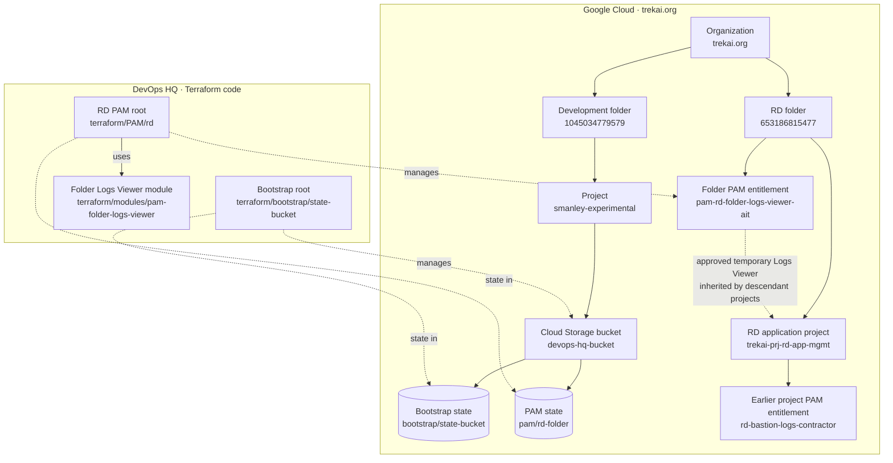

# Google Cloud and Terraform: how the pieces connect

This diagram shows the setup documented on **2026-11-03**. It is not a fresh live inventory. Solid lines show containment or configuration; dashed lines show Terraform state tracking or access relationships. Terraform code lives in `devops-hq`, outside Google Cloud; its state is stored in the bucket.

## Read the diagram

1. **Organization and folders:** `trekai.org` contains a development folder and an RD folder. The state project is in the development folder; the folder-level PAM entitlement is on the separate RD folder. [Bootstrap guide](terraform/bootstrap/state-bucket.md) · [PAM guide](terraform/PAM/rd.md).
2. **Project and bucket:** `smanley-experimental` contains `devops-hq-bucket`. Terraform keeps two independent state records in the bucket: one for the bucket's bootstrap root and one for the RD PAM root. Separate prefixes organize state; they do not by themselves restrict who can read it. The bucket's effective IAM review is on hold. [Bucket IAM plan](terraform/bootstrap/state-bucket-iam.md).
3. **PAM access:** The folder entitlement lets the named contractor *request* up to eight hours of Logs Viewer access; either named approver must approve. Folder permissions can be inherited by descendant projects, including future ones. An entitlement is not an active grant, and successful access to the intended logs remains untested. The earlier project-level entitlement is separate and has not been removed. [PAM guide](terraform/PAM/rd.md).
4. **Terraform:** The bootstrap root manages the bucket; the PAM root uses a reusable module to manage the folder entitlement. State records track those resources; they are not the resources themselves. The project and earlier project entitlement were created separately and are not managed by these Terraform roots. [Terraform practices](terraform-and-agents.md).

No new cloud resources or permissions were created to produce this diagram.
